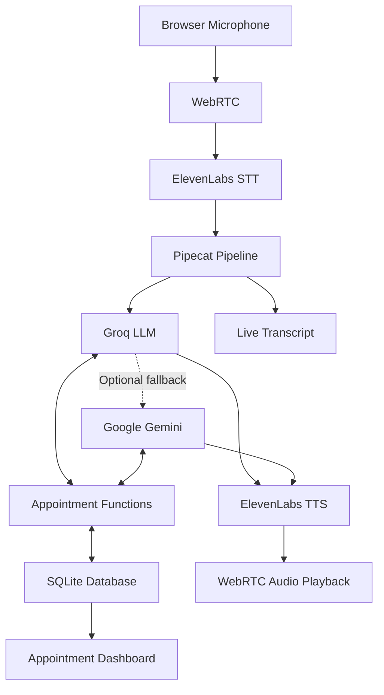

# CareDesk AI

An AI-powered voice receptionist for clinic appointment
management, built using real-time conversational AI.

## Overview

CareDesk AI allows users to interact with a virtual clinic
receptionist through natural voice conversations, check
doctor availability, book appointments and cancel bookings.

## Features

- Real-time AI voice conversations
- Doctor and appointment availability
- Appointment booking and cancellation
- Phone number confirmation
- Live conversation transcripts
- Appointment management dashboard
- Duplicate booking prevention
- Optimized LLM token usage
- Optional Gemini fallback
- Privacy-conscious terminal logging

## Technology Stack

| Component | Technology |
|-----------|------------|
| Frontend | React, Vite, CSS |
| Backend | Python 3.11, FastAPI |
| Voice Framework | Pipecat 0.0.108 |
| Primary LLM | Groq GPT-OSS 20B |
| Optional LLM | Google Gemini |
| Speech-to-Text | ElevenLabs |
| Text-to-Speech | ElevenLabs |
| Voice Transport | WebRTC |
| Voice Activity Detection | Silero VAD |
| Database | SQLite |

## System Architecture



## Local Installation

### Prerequisites

- Python 3.11
- Node.js 20+
- Git
- Groq API key
- ElevenLabs API key
- Google Gemini API key if using fallback

### Backend Setup (Linux / WSL)

```bash
cd backend
python3.11 -m venv .venv
source .venv/bin/activate
python -m pip install -r requirements.txt
cp .env.example .env
```

Configure your API keys in backend/.env.

Default LLM configuration:

```env
LLM_PROVIDER=groq
GROQ_MODEL=openai/gpt-oss-20b
GROQ_MAX_COMPLETION_TOKENS=512
GROQ_REASONING_EFFORT=low
LLM_FALLBACK_ENABLED=false
```

Start the backend:

```bash
python -m uvicorn main:app --host 127.0.0.1 --port 8000 --no-access-log
```

### Frontend Setup

Open a separate terminal from the project root:

```bash
cd frontend
npm install
npm run dev
```

Open http://localhost:5173 in your browser.

Allow microphone access and click Try call.

## API Endpoints

| Method | Endpoint | Purpose |
|--------|----------|---------|
| GET | /api/dashboard | Appointment dashboard |
| POST | /api/offer | WebRTC signaling |
| GET | /api/events/{sid} | Conversation events |
| DELETE | /api/session/{sid} | End call session |

Interactive API documentation:
http://localhost:8000/docs

## Project Structure

```text
caredesk/
├── backend/
│   ├── bot.py
│   ├── main.py
│   ├── db.py
│   ├── test_db.py
│   ├── requirements.txt
│   └── .env.example
├── frontend/
│   ├── src/
│   │   ├── main.jsx
│   │   └── style.css
│   ├── package.json
│   └── vite.config.js
├── .gitignore
└── README.md
```

## Testing

From the backend directory:

```bash
python -m unittest test_db -v
```

Database tests cover booking flow and input validation.

Local manual testing has included voice conversations,
appointment booking and appointment cancellation.

## Security and Privacy

- API keys are stored in environment variables.
- Sensitive files are excluded from Git.
- SQLite transactions help prevent duplicate bookings.
- Terminal conversation logging is restricted.
- Phone confirmation is not identity authentication.
- API quotas and provider availability may vary.

## Limitations

This project is an educational demonstration using fictional
doctors and appointment data.

Do not enter real patient information.

Production deployment requires authentication, authorization,
secure data handling, HTTPS, API rate limiting and appropriate
healthcare privacy compliance.

WebRTC is currently configured for local demonstration.
Remote deployment may require STUN/TURN configuration.

## Future Enhancements

- Secure user authentication
- Multilingual receptionist support
- SMS appointment reminders
- Appointment rescheduling
- Production database integration
- Cloud deployment
- Provider health monitoring and improved failover

## References

- Pipecat: https://docs.pipecat.ai/
- Groq: https://console.groq.com/
- ElevenLabs: https://elevenlabs.io/
- FastAPI: https://fastapi.tiangolo.com/
- Google AI Studio: https://aistudio.google.com/


## Cloud Deployment

CareDesk AI is deployed on AWS EC2 (Mumbai region).

- Dockerized React frontend and FastAPI backend
- AWS ECR for container image storage
- Coturn for WebRTC audio relay
- DuckDNS for domain management
- Caddy reverse proxy with Let's Encrypt HTTPS
- Password-protected demo access
- Persistent SQLite database
- Tested two-way AI voice communication over HTTPS

Live Demo: https://caredesk-ai.duckdns.org

The application is a functional MVP intended for demonstration
using dummy patient information.

## Cloud Deployment

CareDesk AI is deployed on AWS EC2 (Mumbai region).

- Dockerized React frontend and FastAPI backend
- AWS ECR for container image storage
- Coturn for WebRTC audio relay
- DuckDNS for domain management
- Caddy reverse proxy with Let's Encrypt HTTPS
- Password-protected demo access
- Persistent SQLite database
- Tested two-way AI voice communication over HTTPS

Live Demo: https://caredesk-ai.duckdns.org

The application is a functional MVP intended for demonstration
using dummy patient information.
